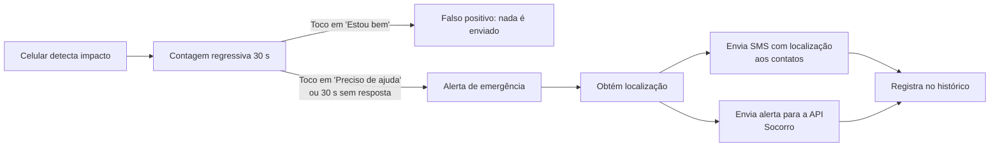
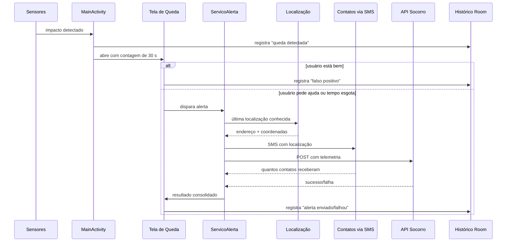

# Me arriba — Documento de Apresentação

> **Resumo em uma frase:** o **Me arriba** é um aplicativo Android que usa os
> sensores do celular para detectar quedas/acidentes e, se o usuário não
> confirmar que está bem, envia automaticamente um **SMS com a localização**
> para os contatos de emergência e um alerta para uma API de socorro.

Este documento foi escrito para explicar o aplicativo a um professor: cobre o
problema, as telas, o fluxo completo, as decisões técnicas, os testes e as
limitações.

---

## 1. O problema

Motociclistas, ciclistas e pedestres podem sofrer quedas em locais onde não há
ninguém por perto. Em uma emergência, a pessoa pode estar inconsciente ou sem
condições de pedir ajuda.

**Pergunta que o app responde:**

> “Se eu cair e não conseguir reagir, como meus contatos descobrem onde estou?”

**Proposta:** usar o próprio celular como um “anjo da guarda”:

1. detectar o impacto;
2. dar uma janela de 30 segundos para a pessoa cancelar (evitar falso positivo);
3. se não houver resposta, avisar automaticamente quem pode ajudar, **com a
   localização**.

---

## 2. Visão geral em 30 segundos



Duas coisas acontecem em paralelo no alerta:

- **Canal direto (SMS):** sai do chip do próprio celular, sem internet.
- **Canal servidor (API):** envia os dados para o sistema de socorro.

---

## 3. As 5 telas do aplicativo

| # | Tela | Classe | Para que serve |
|---|------|--------|----------------|
| 1 | **Início** | `MainActivity` | Ligar/desligar o monitoramento, ver localização, clima, modo de transporte, botão de pânico e “simular queda”. |
| 2 | **Possível queda** | `QuedaDetectadaActivity` | Contagem regressiva de 30 s com dois botões: “Não, estou bem” e “Preciso de ajuda”. |
| 3 | **Status do alerta** | `StatusAlertaActivity` | Mostra o resultado real: API, SMS aos contatos e localização. Permite tentar de novo e compartilhar a localização. |
| 4 | **Configurações** | `ConfiguracoesActivity` | Nome do usuário, contatos de emergência, monitoramento, transporte, check-in, modo demonstração, permissões. |
| 5 | **Histórico** | `HistoricoActivity` | Lista de eventos persistidos, com filtros “Todos / Quedas / Alertas”. |

> O **check-in de segurança** não é uma tela: é um diálogo que aparece sobre a
> tela inicial no intervalo configurado (“Tudo bem por aí?”).

---

## 4. Fluxo completo de uma queda



### Passo a passo

1. O usuário toca em **“Iniciar monitoramento”**. O app registra os sensores e
   pede as permissões de **localização** e **SMS**.
2. O detector percebe o padrão de queda e chama a tela 2.
3. A tela 2 inicia um `CountDownTimer` de **30 segundos** e desenha um anel que
   vai esvaziando.
4. O usuário tem duas saídas:
   - **“Não, estou bem”** → registra um **falso positivo** e não envia nada.
   - **“Preciso de ajuda”** (ou os 30 s terminam) → abre a tela 3.
5. A tela 3 pede a permissão de SMS (se ainda não concedida) e chama o
   `ServicoAlerta`.
6. O `ServicoAlerta`:
   1. obtém a localização;
   2. monta o texto do SMS;
   3. envia o SMS para **cada contato**;
   4. envia o alerta para a API (ou simula, no modo demonstração);
   5. devolve um resultado único.
7. A tela 3 mostra `SMS enviado a N de M`, status da API e da localização, e
   grava o evento no histórico.

---

## 5. Como a detecção de queda funciona

O arquivo `sensor/DetectorQueda.java` combina **acelerômetro** e **giroscópio**.
Não é um modelo de machine learning: é uma **heurística** baseada na física de
uma queda.

### A intuição física

Uma queda típica tem três fases:

```text
   queda livre            impacto             repouso
   (quase 0 g)         (pico de aceleração)   (parado no chão)
      ____                  /\                  ______
_____/    \________________/  \________________/
```

1. **Queda livre:** a aceleração medida cai (o celular “flutua”).
2. **Impacto:** a aceleração sobe muito em poucos instantes.
3. **Rotação brusca:** o giroscópio detecta o corpo girando.

### Limites usados no código

| Constante | Valor | Significado |
|-----------|-------|-------------|
| `LIMITE_QUEDA_LIVRE` | `3,5 m/s²` | abaixo disso, considera queda livre |
| `LIMITE_IMPACTO` | `25 m/s²` | acima disso, considera impacto forte |
| `LIMITE_GIRO` | `3,0 rad/s` | rotação brusca no giroscópio |
| `JANELA_QUEDA_MS` | `1.200 ms` | queda livre e impacto precisam estar próximos |
| `INTERVALO_MINIMO_MS` | `8.000 ms` | evita disparos repetidos em sequência |

**Regra de disparo:** houve impacto forte **e** (queda livre recente **ou**
rotação brusca recente), respeitando o intervalo mínimo de 8 segundos.

### Por que existe o botão “Simular queda (teste)”

Acelerômetro e giroscópio **não funcionam no emulador**. O botão injeta um
evento de teste marcado como **SIMULADO**, permitindo demonstrar todo o fluxo
sem sacudir o celular.

### Por que o botão “Estou bem” é importante

A heurística pode errar (por exemplo: uma freada forte). Por isso o app **nunca
dispara um alerta imediatamente**: ele dá 30 segundos para a pessoa cancelar.
Esse é o principal mecanismo de segurança contra falsos positivos.

---

## 6. Localização

Arquivo: `alerta/ProvedorLocalizacao.java`.

- Verifica se a permissão de localização foi concedida.
- Consulta a **última localização conhecida** nos provedores `GPS`, `NETWORK` e
  `PASSIVE`, escolhendo a mais recente.
- Tenta transformar coordenadas em **endereço legível** com o `Geocoder`
  (ex.: “Rua X, 123 - Cidade”).
- Se o endereço não puder ser obtido, usa as coordenadas como texto
  (`-23.55052, -46.63331`), sem impedir o envio.

> O app usa “última localização conhecida” por simplicidade e velocidade. Em
> uma emergência, é melhor mandar uma posição recente do que esperar o GPS
> travar.

---

## 7. SMS automático (o coração do trabalho)

Arquivo: `alerta/EnviadorSms.java`.

O SMS é enviado pelo **chip do próprio aparelho**, usando a classe
`android.telephony.SmsManager`. **Não depende de internet, servidor ou API de
mensageria** — o que é essencial em uma emergência.

### Texto enviado

```text
Me arriba: Ana Clara pode ter sofrido uma queda e precisa de ajuda.
Localização: Rua das Flores, 123 - São Paulo
Mapa: https://maps.google.com/?q=-23.550520,-46.633310
```

### Detalhes técnicos

- Envia para **todos** os contatos cadastrados.
- Mensagens longas são divididas automaticamente com `divideMessage()`.
- O envio é feito com `sendTextMessage()` / `sendMultipartTextMessage()`.
- Cada contato é tratado individualmente: se um número falhar, os outros ainda
  recebem.
- O resultado informa **quantos** contatos receberam o SMS.

### Padrão do telefone (E.164)

Arquivo: `dados/TelefoneUtil.java`.

O telefone é validado e salvo no padrão internacional **E.164**
(`+5511999998888`). Ao cadastrar, o app:

| Usuário digita | App salva |
|---|---|
| `(11) 99999-8888` | `+5511999998888` |
| `011 99999-8888` | `+5511999998888` |
| `021 11 99999-8888` | `+5511999998888` |
| `+55 11 99999-8888` | `+5511999998888` |
| `+351 912 345 678` | `+351912345678` |

Regras: remove máscara, remove zero de tronco e código de operadora, completa
`+55` para números nacionais e valida DDD + tamanho. Números internacionais
com `+` são preservados.

### Permissão

O app declara `SEND_SMS` no `AndroidManifest.xml`, mas o Android exige
autorização explícita do usuário. Por isso a permissão é pedida:

1. ao iniciar o monitoramento;
2. novamente na tela de status, se ainda não estiver concedida.

Se o usuário negar, a tela mostra **“Permissão de SMS negada”** — o app não
esconde o problema.

---

## 8. Integração com a API Socorro

Arquivos: `telemetria/EnviadorTelemetria.java` e `dados/RepositorioConfiguracoes.java`.

- **Endpoint padrão:** `https://ideaberta.com.br/socorro/`
- **Método:** `POST` com corpo `application/x-www-form-urlencoded`.
- **Sucesso:** HTTP 2xx **e** a resposta contendo `"status":"sucesso"`.
- **Modo demonstração:** quando ativado nas configurações **ou** quando o
  endpoint está vazio. Nesse caso o envio à API é simulado (1,5 s), mas o
  **SMS continua real** — isso está indicado na interface.

### Campos enviados

| Campo | Origem |
|---|---|
| `usuario` | nome configurado pelo usuário |
| `modelo` | fabricante + modelo do aparelho |
| `device_id` | `ANDROID_ID` (ou UUID local) |
| `bateria` | percentual da bateria |
| `tipo` | `1` = normal, `2` = queda |
| `queda` | impacto em G |
| `velocidade` | km/h (se disponível) |
| `temperatura` | sensor ambiente (se disponível) |
| `pressao` | barômetro (se disponível) |
| `latitude` / `longitude` | localização no momento |

> **Importante para a explicação:** o app **não afirma** que o contato leu a
> mensagem. Ele informa que o SMS foi **entregue à operadora** e que a API
> **respondeu com sucesso**. Confirmação de leitura não existe para SMS comum.

---

## 9. Clima (recurso extra)

Arquivo: `clima/ProvedorClima.java`.

- Consulta a **OpenWeather** (`Current Weather API`) com latitude/longitude.
- Mostra temperatura e descrição no cartão “Clima atual”.
- Gera alertas de atenção para:
  - tempestade (códigos 2xx);
  - chuva (3xx–5xx);
  - vento forte (≥ 10 m/s).
- A chave é lida de `local.properties` (`OPENWEATHER_API_KEY`). Sem chave, o
  cartão mostra “Clima indisponível”, sem quebrar o app.

---

## 10. Histórico de eventos

Arquivos: `dados/EventoEntidade.java`, `EventoDao.java`, `BancoDados.java`,
`RepositorioEventos.java`.

- Banco local **Room** (SQLite), tabela `eventos`.
- Cada evento tem: `id`, `type`, `timestamp`, `title`, `detail`.
- Tipos registrados:

| Tipo | Quando ocorre |
|---|---|
| `queda_detectada` | impacto reconhecido |
| `falso_positivo` | usuário tocou em “Estou bem” |
| `alerta_solicitado` | tela de status aberta |
| `alerta_enviado` | API confirmou |
| `alerta_falhou` | API não confirmou |
| `checkin` | usuário respondeu ao check-in |

- As operações de banco rodam **fora da thread de interface**, com
  `ExecutorService`, e o resultado volta para a thread principal com `Handler`.
- O histórico **sobrevive ao fechamento do app** (é persistido em disco).

---

## 11. Configurações e persistência

Arquivo: `dados/RepositorioConfiguracoes.java`.

Preferências salvas em `SharedPreferences` (`me_arriba_prefs`):

- monitoramento ligado/desligado;
- modo de transporte (moto, bicicleta, caminhada);
- check-in ligado/desligado e intervalo (1, 5, 10, 15, 30 ou 60 min);
- modo demonstração;
- endpoint da API;
- nome do usuário;
- lista de contatos de emergência (serializada em **JSON**).

---

## 12. Arquitetura do código

O projeto separa responsabilidades em pacotes:

```text
com.reserva.sensor_queda
├── MainActivity                 → Tela 1 e orquestração do monitoramento
├── ui/                          → Telas 2 a 5, adaptador e utilitários
│   ├── QuedaDetectadaActivity
│   ├── StatusAlertaActivity
│   ├── ConfiguracoesActivity
│   ├── HistoricoActivity
│   ├── AdaptadorEvento
│   └── UtilitariosEvento
├── sensor/DetectorQueda         → acelerômetro + giroscópio
├── alerta/                      → regra de negócio do alerta
│   ├── ServicoAlerta            → orquestra localização + SMS + API
│   ├── EnviadorSms              → SMS pelo SmsManager
│   ├── ProvedorLocalizacao      → GPS + Geocoder
│   ├── EnviadorAlerta           → interface do canal de alerta
│   ├── EnviadorAlertaSimulado   → modo demonstração
│   └── ResultadoAlerta          → resultado consolidado
├── telemetria/                  → API Socorro e dados do aparelho
├── clima/ProvedorClima          → OpenWeather
├── dados/                       → Room, preferências e normalização
└── componente/                  → anel de progresso customizado
```

### Por que essa separação importa

- **Sensor não conhece UI:** o detector apenas avisa “possível queda”.
- **UI não conhece detalhes de rede:** a tela chama `ServicoAlerta`.
- **Canais são intercambiáveis:** API real e simulada implementam a mesma
  interface (`EnviadorAlerta`).
- Isso facilita **testar**, **trocar** o canal de envio e **explicar** o código.

---

## 13. Tecnologias utilizadas

| Tecnologia | Uso |
|---|---|
| **Java 11** | linguagem do app |
| **XML + Material 3** | interface (tema escuro) |
| **Android SDK 36** | compilação (`minSdk 29`) |
| **SensorManager** | acelerômetro, giroscópio, temperatura, pressão |
| **SmsManager** | envio de SMS |
| **LocationManager + Geocoder** | localização e endereço |
| **Room (SQLite)** | histórico local |
| **SharedPreferences + JSON** | configurações e contatos |
| **HttpURLConnection** | API Socorro |
| **OpenWeather API** | clima |
| **Gradle** | build |

### Fluxo de build

```powershell
.\gradlew.bat :app:assembleDebug
# APK: app\build\outputs\apk\debug\app-debug.apk
```

Para rodar os testes de normalização de telefone:

```powershell
.\gradlew.bat :app:testDebugUnitTest
```

---

## 14. Permissões e privacidade

| Permissão | Por quê |
|---|---|
| `ACCESS_FINE_LOCATION` / `ACCESS_COARSE_LOCATION` | obter a localização no alerta |
| `SEND_SMS` | enviar o SMS de emergência |
| `INTERNET` / `ACCESS_NETWORK_STATE` | API Socorro e clima |
| `POST_NOTIFICATIONS` | declarada e reservada para um futuro serviço em segundo plano |

**Privacidade:**

- contatos, nome e histórico ficam **somente no aparelho**;
- não há login nem nuvem;
- a localização só é enviada **quando um alerta é disparado**;
- o SMS só é enviado após autorização explícita da permissão.

---

## 15. Limitações (seja honesto na apresentação)

1. **A detecção é heurística.** Não é infalível; precisa de calibração e testes
   em campo. Pode gerar falsos positivos e falsos negativos.
2. **Monitoramento em primeiro plano.** O MVP registra sensores enquanto a tela
   está ativa (`onResume`/`onPause`). Um **serviço em primeiro plano** com
   notificação seria necessário para funcionar com o app fechado.
3. **SMS não confirma leitura.** Sabemos que foi aceito pela operadora, não que
   foi lido.
4. **Depende de chip/SIM.** Em aparelho sem telefonia (ou emulador), o SMS
   falha — e o app mostra a falha.
5. **Custo do SMS.** O envio pode ser cobrado pela operadora.
6. **Política da Play Store.** Apps que enviam SMS precisam justificar o uso;
   `SEND_SMS` é uma permissão sensível.
7. **Clima depende de chave de API** configurada em `local.properties`.
8. **Um número por contato.** Não há suporte a múltiplos números por pessoa.
9. **Sem WhatsApp.** O SMS é o canal local; WhatsApp exigiria API externa.

---

## 16. Roteiro de demonstração (5 a 7 minutos)

> Sugestão de ordem para apresentar ao professor.

1. **Contexto (30 s):** “Quedas podem deixar a pessoa sem condições de pedir
   ajuda. O app tenta resolver isso automaticamente.”
2. **Configurações (1 min):**
   - preencha o nome;
   - adicione um contato com `(11) 99999-8888` e mostre que ele é salvo como
     `+5511999998888`;
   - mostre as opções de transporte e check-in.
3. **Permissões (30 s):** inicie o monitoramento e mostre o pedido de
   localização + SMS.
4. **Demonstração principal (2 min):**
   - toque em **“Simular queda (teste)”**;
   - mostre a contagem de 30 s;
   - toque em **“Preciso de ajuda”**;
   - na tela de status, mostre SMS enviado, status da API e localização.
5. **Falso positivo (1 min):** simule outra queda e toque em **“Não, estou
   bem”**; explique que nada é enviado.
6. **Histórico (1 min):** abra a tela 5 e mostre os eventos gravados, incluindo
   o falso positivo.
7. **Código (1 min):** abra `DetectorQueda.java` e `EnviadorSms.java` e explique
   os limites físicos e o envio pelo `SmsManager`.

### Dica para evitar surpresas

- Use um **celular físico** para demonstrar o SMS (emulador não tem chip).
- Cadastre um contato que você controla.
- Deixe a permissão de SMS já concedida antes da apresentação.

---

## 17. Perguntas prováveis do professor

**“Como vocês evitam falsos positivos?”**
Com a contagem de 30 segundos e o botão “Estou bem”. Além disso, o detector
exige combinação de queda livre/rotação com impacto e um intervalo mínimo de
8 segundos entre disparos.

**“Por que SMS e não internet?”**
SMS funciona sem dados móveis e usa apenas o sinal da operadora, sendo mais
confiável em áreas remotas. A API complementa com telemetria.

**“O que acontece se a localização falhar?”**
O SMS ainda é enviado, com o texto “Localização indisponível no momento”. A API
também é chamada com os demais dados.

**“Como garantem que o contato recebeu?”**
Não garantimos leitura. O app informa que o SMS foi **aceito para envio** e
mostra quantos contatos foram atingidos. Confirmação de leitura não existe em
SMS comum.

**“Os dados são enviados para a nuvem?”**
Não. Nome, contatos e histórico ficam no aparelho. Só há envio externo no
momento do alerta (API e SMS) e na consulta de clima.

**“Por que usar Room?”**
Porque o histórico precisa sobreviver ao fechamento do app e ser consultado
com filtros. Room reduz código repetitivo sobre SQLite e evita acesso ao banco
na thread de interface.

**“O app funciona com a tela apagada?”**
Hoje não. O sensoriamento para quando a tela sai do primeiro plano. Um serviço
em primeiro plano com notificação é a evolução natural.

---

## 18. Glossário rápido

| Termo | Significado |
|---|---|
| **Acelerômetro** | mede aceleração (incluindo a gravidade) |
| **Giroscópio** | mede rotação |
| **G (força G)** | múltiplo da aceleração da gravidade |
| **E.164** | padrão internacional de numeração (`+55...`) |
| **SmsManager** | API do Android para enviar SMS |
| **Geocoder** | converte coordenadas em endereço |
| **Room** | biblioteca de banco de dados do Android |
| **SharedPreferences** | armazenamento chave-valor local |
| **API** | interface de comunicação com um servidor |
| **Heurística** | regra prática baseada em padrões, não em garantia matemática |
| **Falso positivo** | o app achou que houve queda, mas não houve |
| **Falso negativo** | houve queda, mas o app não detectou |

---

## 19. Conclusão

O **Me arriba** demonstra, de ponta a ponta, um fluxo de emergência:

**sensores → decisão com confirmação humana → localização → SMS + API →
histórico.**

O ponto mais importante do projeto é a combinação de **automação** (detectar e
avisar sozinho) com **controle do usuário** (30 segundos para cancelar e
permissões explícitas). O SMS com localização é o recurso que fecha o ciclo:
mesmo sem internet, alguém fica sabendo **que** houve uma queda e **onde** ela
aconteceu.
